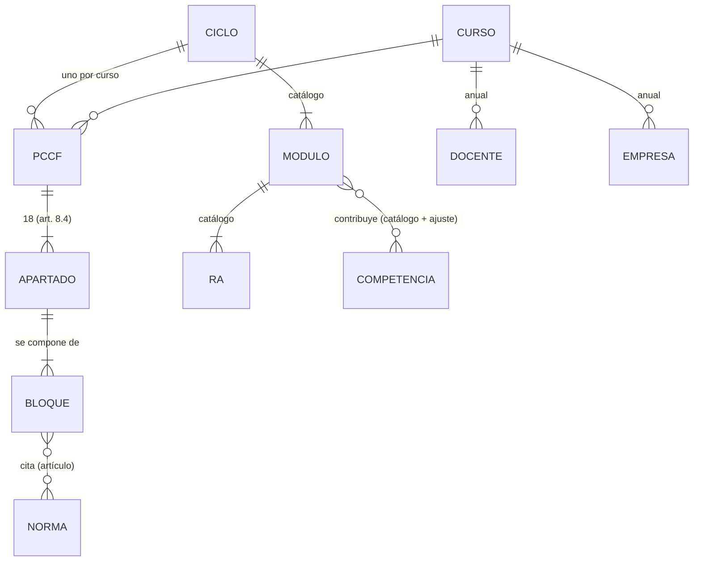

# PCCF — arquitectura

Cómo está hecha la app. Producto: [PRD.md](PRD.md) · diseño: [DESIGN.md](DESIGN.md) · decisiones: [docs/DECISIONES.md](docs/DECISIONES.md).

## 1. Stack

| Pieza | Elección | Por qué |
| --- | --- | --- |
| Lenguaje | Python 3.11 | El de Programaciones y Partes de salida |
| Interfaz | PyQt6 6.7 (mismas versiones que Programaciones) | Se copian sus componentes (`ui/`), su diseño y su empaquetado; `QTextEdit` edita Markdown |
| Datos | YAML (datos) + Markdown con cabecera YAML (textos), validados con JSON Schema (`jsonschema`) | Legibles y editables a mano; git da versionado y comparación |
| Documento | Plantilla `.docx` con marcas y motor propio con `lxml`, copiados de Programaciones (`documento.py`, ADR-019 de allí) | Conserva encabezado, pie, estilos e índice; resuelve hipervínculos de normativa y tablas |
| PDF | Word del equipo (AppleScript en macOS, COM en Windows), como Programaciones | Sin dependencias nuevas |
| Catálogo | El publicado y firmado por Programaciones (rama `catalogo-publicado`, firma Ed25519 que la app verifica con `cryptography`) | Un solo dato oficial para las dos apps |
| Red | Solo BOE, DOGV, página de normativa de FP de la Conselleria y catálogo publicado | RNF-1 |
| Empaquetado | PyInstaller e Inno Setup en GitHub Actions (nunca en local), copiados de Programaciones | Instaladores para el equipo |
| Entorno | `~/.venvs/pccf` (fuera de iCloud) | Como Programaciones |

**Alternativas descartadas:** app web local (FastAPI o Flask con HTMX en el navegador: otra interfaz y otro empaquetado distintos de la familia, y un servidor local que gestionar) y NiceGUI o Streamlit (prototipo rápido, pero sin control de la interfaz ni componentes que reutilizar; el Word costaría lo mismo).

## 2. Componentes

```
src/pccf/
  catalogo.py      lee y verifica el catálogo de Programaciones (copia de su lector)
  datos.py         carga la carpeta de datos, valida con los esquemas y da el modelo en memoria
  bloques.py       bloques Markdown con cabecera: tipo, apartado, estado, autoría, citas
  derivados.py     tablas calculadas (módulo × competencia, distribución horaria, RA en FE…)
  citas.py         índice inverso norma → bloques que la citan
  documento.py     rellena la plantilla con marcas (copia adaptada de Programaciones)
  cursos.py        «Nuevo curso» (clonar) y «Comparar» (diferencias por apartado)
  vigia.py         consulta BOE, DOGV y Conselleria; informe de bloques afectados
  ui/              interfaz PyQt6 (copiada de Programaciones)
  recursos/plantilla/
esquemas/          JSON Schema de cada archivo de datos
tests/             pytest con datos ficticios
```

## 3. Modelo de datos



| Entidad | Origen | Notas |
| --- | --- | --- |
| Ciclo, Módulo, RA, Criterio, Competencia, horas | Catálogo de Programaciones, solo lectura: los 15 ciclos del centro (GB, GM y GS) de todas las familias | Llevan su fuente; un cambio llega por el vigía |
| Familia o departamento | Del catálogo (familia profesional) y `centro/departamentos.yaml` de la carpeta de datos (qué departamento lleva cada ciclo) | Para agrupar los ciclos y saber qué jefatura aprueba |
| Curso académico | `cursos/AAAA-AAAA/` en la carpeta de datos | |
| PCCF | Ciclo × curso | Estado: borrador, revisado, aprobado (fecha y órgano) |
| Apartado | Lista fija **por grado** en `src/pccf/recursos/apartados/` (GM-GS: los 18 del Decreto 114/2025, art. 8.4; GB: los 17 del Decreto 117/2025, art. 8.4; títulos literales) y los de la Resolución del curso | Cada uno dice qué bloques admite y de qué tipo |
| **Bloque** | Markdown con cabecera YAML | `tipo` (`centro`, `ciclo`, `anual`, `normativo`, `derivado`), `apartado`, `origen` (catálogo, equipo, heredado del curso X), `estado` (borrador o confirmado), `aportado_por`, `fecha`, `citas` (norma y artículo) |
| Norma | `normativa.yaml` del catálogo + normas propias del centro (`normativa.yaml` de la carpeta de datos) | Id BOE o DOGV, título, enlace, vigencia, fecha de comprobación |
| Cita | Calculada al cargar | Índice inverso para el vigía |
| Ajustes del equipo | `ciclos/<SIGLA>/ajustes.yaml` | Ponderación de competencias (%) y cambios a la tabla de contribución, cada uno con su motivo |
| Docente, Empresa | `cursos/<curso>/<SIGLA>/` | Datos personales: solo en la carpeta de datos |
| Derivado | Nunca se guarda | Se calcula al generar |

## 4. Carpetas

```
03 APPS Y WEBS/PCCF (python)/
  PCCF - CÓDIGO FUENTE/      repositorio de la app (código, esquemas, plantilla, pruebas con datos ficticios)
  PCCF - DATOS/              carpeta de datos con su propio git (de CarlosFB; nunca en GitHub público)
    centro/                  bloques de centro (atencion-diversidad.md, plan-tutoria.md, ideario.md…)
    normativa.yaml           normas propias del centro
    centro/departamentos.yaml  qué departamento lleva cada ciclo
    ciclos/SEA/              una carpeta por ciclo (los 15 del centro)
      ajustes.yaml
      bloques/               bloques de ciclo redactados por el equipo
    cursos/2026-2027/
      curso.yaml             calendario y planes del centro
      SEA/                   equipo docente, empresas de FE y bloques anuales
    salidas/                 .docx generados (fuera de git)
```

Versionado: un commit por cambio aprobado y una etiqueta por versión aprobada (`SEA-2026-2027-v1`). «Comparar» lee dos cursos o dos etiquetas y muestra las diferencias por apartado.

## 5. Vigía

Amplía el de Programaciones, que ya consulta el BOE, el DOGV y la página de normativa de FP de la Conselleria y guarda lo visto en su `catalogo/vigia.yaml`.

| Fuente | Cómo |
| --- | --- |
| Normas consolidadas del BOE | API de datos abiertos, sin clave, con `Accept: application/json`: `legislacion-consolidada/id/{id}/metadatos` (vigencia, derogación, `fecha_actualizacion`) y `/analisis` (referencias posteriores: 270 modifica, 210 deroga, 201 corrección; filtrar 440 «se dicta de conformidad») |
| Reales decretos de título (sin consolidar) | XML del diario, `/diario_boe/xml.php?id=…`, `<analisis><referencias><posteriores>` |
| Normas del DOGV | Sin API ni RSS: huella SHA-256 del PDF de cada norma registrada y comparación de la página de normativa de FP de la Conselleria entre ejecuciones |

Salida: informe en Markdown con cada norma cambiada (qué cambia, enlace) y los bloques que la citan (índice de `citas.py`). **No toca ningún texto.** El resumen con un modelo de lenguaje, si se hace, solo con un modelo local.

## 6. Versiones, compilación y actualizaciones

Como Programaciones (su `TRD.md` §6 y sus flujos de `.github/workflows/`), con el mismo código:
- **Repositorio público** `github.com/cferrerobonet/PCCF`, rama `main`; licencia MIT.
- **Versión:** en `pyproject.toml`, SemVer. Cerrar una versión = entrada en `CHANGELOG.md`, commit, etiqueta `vX.Y.Z` y push de la etiqueta.
- **Compilación:** la etiqueta lanza `compilar.yml` (PyInstaller e Inno Setup, nunca en local), que publica la release con el DMG de macOS, el instalador y el portable de Windows y el portable de Linux; las notas de la release son la entrada del `CHANGELOG.md`.
- **Actualización:** al arrancar y desde «Acerca de», la app consulta `releases/latest`; si hay una versión mayor, botón dorado «↑ Actualizar a X.Y.Z» y ventana de novedades con su entrada del `CHANGELOG.md`; en macOS, un script aparte sustituye la app y la vuelve a abrir.
- **Seguridad:** barrera de secretos (`scripts/comprobar_secretos.sh`, gancho global y CI «Secretos»); en el repositorio solo código, esquemas, plantilla y datos ficticios.

## 7. Pruebas

- `pytest` con una carpeta de datos ficticia en `tests/datos/` (docentes y empresas inventados).
- El Word generado se comprueba convertido a PDF, mirando todas las páginas.
- El vigía, con respuestas del BOE grabadas (sin red en las pruebas).
