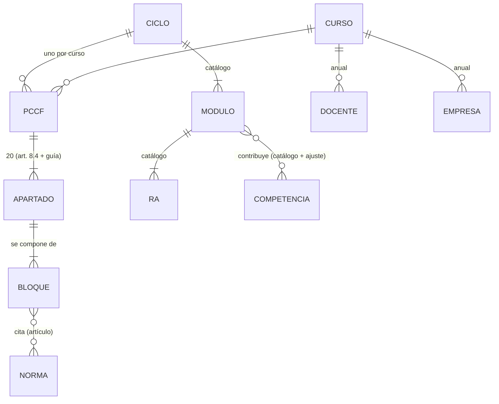

# PCCF — arquitectura

Cómo está hecha la app. Producto: [PRD.md](PRD.md) · diseño: [DESIGN.md](DESIGN.md) · decisiones: [docs/DECISIONES.md](docs/DECISIONES.md).

## 1. Stack

| Pieza | Elección | Por qué |
| --- | --- | --- |
| Lenguaje | Python 3.11 | El de Programaciones y Partes de salida |
| Interfaz | PyQt6 6.7 (mismas versiones que Programaciones) | Se copian sus componentes (`ui/`), su diseño y su empaquetado; `QTextEdit` edita Markdown |
| Datos | YAML (datos) + Markdown con cabecera YAML (textos), validados con JSON Schema (`jsonschema`) | Legibles y editables a mano; git da versionado y comparación |
| Documento | Plantilla propia construida por `scripts/plantilla.py` con las fuentes Barlow incrustadas, y cuerpo escrito con `lxml` (ADR-013 y ADR-015) | Diseño propio del PCCF (`DESIGN.md` § Documento), igual en cualquier equipo; el cuerpo sale de los datos |
| PDF | Word del equipo (AppleScript en macOS, COM en Windows), como Programaciones | Sin dependencias nuevas |
| Catálogo | El publicado y firmado por Programaciones (rama `catalogo-publicado`, firma Ed25519 que la app verifica con `cryptography`) | Un solo dato oficial para las dos apps |
| Red | Solo BOE, DOGV, página de normativa de FP de la Conselleria y catálogo publicado | RNF-1 |
| Empaquetado | PyInstaller e Inno Setup en GitHub Actions (nunca en local), copiados de Programaciones | Instaladores para el equipo |
| Entorno | `~/.venvs/pccf` (fuera de iCloud) | Como Programaciones |

**Alternativas descartadas:** app web local (FastAPI o Flask con HTMX en el navegador: otra interfaz y otro empaquetado distintos de la familia, y un servidor local que gestionar) y NiceGUI o Streamlit (prototipo rápido, pero sin control de la interfaz ni componentes que reutilizar; el Word costaría lo mismo).

## 2. Componentes

```
src/pccf/
  catalogo.py      lee el catálogo de Programaciones (copia de su lector); en desarrollo, el de su repositorio, al lado
                   (`PCCF_CATALOGO` lo cambia); la descarga del publicado y firmado llega con el empaquetado
  apartados.py     apartados por grado, con títulos literales y su punto de la guía de la DGFP
                   (`recursos/apartados/gm-gs.yaml`: los 18 del art. 8.4 y el 19 y el 20 de la guía, ADR-014)
  datos.py         carga la carpeta de datos (`PCCF_DATOS`; en desarrollo, `../PCCF - DATOS/`), la valida con los
                   esquemas y da el modelo en memoria; lo que falta llega como None («pendiente»)
  bloques.py       bloques Markdown con cabecera: tipo, apartado, estado, autoría, citas
  derivados.py     lo calculado: identificación (1), marco normativo (2), módulo × competencia (4); después,
                   distribución horaria, RA en FE…
  citas.py         índice inverso norma → apartados y bloques que se apoyan en ella (citas de los bloques, por id
                   o por nombre, y lo que se calcula del catálogo); la cita que no casa con una sola norma, sin vigilar
  documento.py     el Word (ADR-015): portada, control del documento, contenido enlazado, apartados con su apertura y
                   lo que pide la guía si están pendientes, matriz apaisada y anexos A y B; borrador en portada y
                   encabezado si queda algo pendiente o en borrador
  ooxml.py         paquete .docx en memoria, relaciones y utilidades de párrafo (copia de Programaciones)
  __main__.py      sin interfaz: `python -m pccf generar|comprobar|vigia <SIGLA> <curso>`
  cursos.py        «Nuevo curso» (clonar) y «Comparar» (diferencias por apartado)
  vigia.py         compara el catálogo con la última revisión del PCCF (ADR-016); informe de apartados y bloques
                   afectados
  ui/              interfaz PyQt6 (copiada de Programaciones)
  esquemas/        JSON Schema de cada archivo de datos (bloque, equipo, departamentos)
  recursos/apartados/ · recursos/plantilla/
scripts/plantilla.py  crea la plantilla desde cero, con las fuentes incrustadas, y la comprueba (ADR-015)
tests/             pytest con un catálogo y una carpeta de datos ficticios (`tests/datos/`)
```

## 3. Modelo de datos



| Entidad | Origen | Notas |
| --- | --- | --- |
| Ciclo, Módulo, RA, Criterio, Competencia, horas | Catálogo de Programaciones, solo lectura: los 15 ciclos del centro (GB, GM y GS) de todas las familias | Llevan su fuente; un cambio llega por el vigía |
| Familia o departamento | Del catálogo (familia profesional) y `centro/departamentos.yaml` de la carpeta de datos (qué departamento lleva cada ciclo) | Para agrupar los ciclos y saber qué jefatura aprueba |
| Curso académico | `cursos/AAAA-AAAA/` en la carpeta de datos | |
| PCCF | Ciclo × curso | Estado: borrador, revisado, aprobado (fecha y órgano) |
| Apartado | Lista fija **por grado** en `src/pccf/recursos/apartados/` (GM-GS: los 18 del Decreto 114/2025, art. 8.4, y el 19 y el 20 de la guía de la DGFP; GB: los 17 del Decreto 117/2025, art. 8.4, y los de la guía; títulos literales), cada uno con su punto de la guía (`guia`) y su origen (`norma` o `guia`) | Cada uno dice qué bloques admite y de qué tipo |
| **Bloque** | Markdown con cabecera YAML | `tipo` (`centro`, `ciclo`, `anual`, `normativo`, `derivado`), `apartado`, `origen` (catálogo, equipo, heredado del curso X, o propuesta: texto sugerido que el equipo revisa), `estado` (borrador o confirmado), `aportado_por`, `fecha`, `citas` (norma y artículo) |
| Norma | `normativa.yaml` del catálogo + normas propias del centro (`normativa.yaml` de la carpeta de datos) | Id BOE o DOGV, título, enlace, vigencia, fecha de comprobación |
| Cita | Calculada al cargar | Índice inverso para el vigía |
| Ajustes del equipo | `ciclos/<SIGLA>/ajustes.yaml` | Ponderación de competencias (%) y cambios a la tabla de contribución, cada uno con su motivo |
| Docente, Empresa | `cursos/<curso>/<SIGLA>/equipo.yaml` (docentes con código, tutorías y docentes de cada módulo por su clave del catálogo; las optativas, por su identificador, «OPT-EE-IA») y, después, `empresas.yaml` | Datos personales: solo en la carpeta de datos |
| Derivado | Nunca se guarda | Se calcula al generar |

## 4. Carpetas

```
03 APPS Y WEBS/PCCF (python)/
  GUÍA PCCF (DGFP 2024-2025)/  la guía de la DGFP: PDF, espejo troceado e índice (base del contenido, ADR-014)
  Maqueta v0 (2026-10-28)/     maqueta de la interfaz (aprobada)
  Maqueta documento v1 (2026-11-04)/  maqueta del Word (aprobada, ADR-015)
  PCCF - CÓDIGO FUENTE/      repositorio de la app (código, esquemas, plantilla, pruebas con datos ficticios)
  PCCF - DATOS/              carpeta de datos con su propio git (de CarlosFB; nunca en GitHub público)
    centro/                  bloques de centro (atencion-diversidad.md, plan-tutoria.md, ideario.md…)
    normativa.yaml           normas propias del centro
    centro/departamentos.yaml  qué departamento lleva cada ciclo y su jefatura (uno por familia en GM y GS, y uno de Grado Básico: ADR-012)
    ciclos/SEA/              una carpeta por ciclo (los 15 del centro)
      ajustes.yaml
      bloques/               bloques de ciclo redactados por el equipo
    cursos/2026-2027/
      curso.yaml             calendario y planes del centro
      SEA/                   equipo docente, empresas de FE, bloques anuales y `vigia.yaml` (lo dado por revisado)
    salidas/                 .docx generados e informes del vigía (fuera de git)
```

Versionado: un commit por cambio aprobado y una etiqueta por versión aprobada (`SEA-2026-2027-v1`). «Comparar» lee dos cursos o dos etiquetas y muestra las diferencias por apartado.

## 5. Vigía

Amplía el de Programaciones sin repetir sus consultas (ADR-016): **no sale a la red**. El de Programaciones revisa cada semana el BOE, el DOGV y la página de normativa de FP de la Conselleria y deja lo visto en el catálogo; el del PCCF compara ese catálogo con lo que se dio por revisado del PCCF de un ciclo y un curso y dice qué apartados y bloques se apoyan en cada norma que ha cambiado.

| Qué mira | Dónde lo deja el vigía de Programaciones |
| --- | --- |
| Documento publicado distinto (huella SHA-256; en el DOGV, sus anexos se revisan a mano) | `catalogo/fuentes.yaml` |
| Referencias posteriores del real decreto de cada ciclo (modifica, deroga, corrección; sin «se dicta de conformidad») | `catalogo/ciclos/<SIGLA>.yaml`, `rd.posteriores` |
| Título y enlace; normas que entran o salen del marco normativo del ciclo | `catalogo/normativa.yaml` |
| Fecha y vigencia del texto consolidado del BOE; disposiciones nuevas del BOE y de la página de la Conselleria | `catalogo/vigia.yaml`: solo en el catálogo de desarrollo (el publicado no lo lleva, y el informe lo avisa) |

Usos de cada norma (`citas.py`): las citas de los bloques (por id del catálogo o por nombre: «Decreto 114/2025», «Orden 20/2019») y lo que se calcula del catálogo (apartado 1: real decreto del título y horario; 2: marco normativo; 3 y 4: competencias del título; 7: horario; la lista de apartados: el decreto de currículos). La cita que no casa con una sola norma queda **sin vigilar** y sale en el informe.

Uso: `python -m pccf vigia <SIGLA> <curso>` escribe el informe en Markdown en `salidas/` (cada norma cambiada, qué cambia, enlace y dónde se usa; las normas citadas no vigentes; las disposiciones nuevas; las citas sin vigilar). Solo lee: un aviso no desaparece por ejecutarlo. `--revisado` guarda en `cursos/<curso>/<SIGLA>/vigia.yaml` lo que dice hoy el catálogo de las normas que usa el PCCF: el punto de partida de la próxima revisión; la primera vez no hay con qué comparar. **No toca ningún texto** ni lleva resumen generado con un modelo de lenguaje (ADR-010).

## 6. Versiones, compilación y actualizaciones

Como Programaciones (su `TRD.md` §6 y sus flujos de `.github/workflows/`), con el mismo código:
- **Repositorio público** `github.com/cferrerobonet/PCCF`, rama `main`; licencia MIT.
- **Versión:** en `pyproject.toml`, SemVer. Cerrar una versión = entrada en `CHANGELOG.md`, commit, etiqueta `vX.Y.Z` y push de la etiqueta.
- **Compilación:** la etiqueta lanza `compilar.yml` (PyInstaller e Inno Setup, nunca en local), que publica la release con el DMG de macOS, el instalador y el portable de Windows y el portable de Linux; las notas de la release son la entrada del `CHANGELOG.md`.
- **Actualización:** al arrancar y desde «Acerca de», la app consulta `releases/latest`; si hay una versión mayor, botón dorado «↑ Actualizar a X.Y.Z» y ventana de novedades con su entrada del `CHANGELOG.md`; en macOS, un script aparte sustituye la app y la vuelve a abrir.
- **Seguridad:** barrera de secretos (`scripts/comprobar_secretos.sh`, gancho global y CI «Secretos»); en el repositorio solo código, esquemas, plantilla y datos ficticios.

## 7. Pruebas

- `pytest` con una carpeta de datos ficticia en `tests/datos/` (docentes y empresas inventados).
- El Word generado se comprueba convertido a PDF, mirando todas las páginas.
- El índice de citas y el vigía, con un catálogo ficticio que las pruebas cambian (huellas, referencias posteriores, consolidados, normas que entran y salen): sin red.
